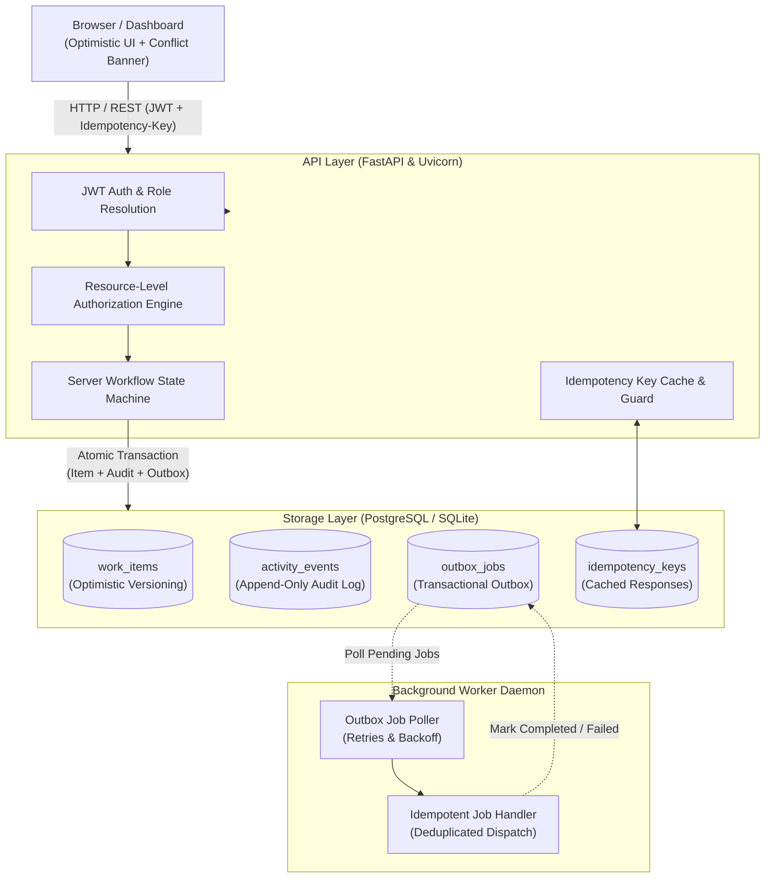

# Newtonite — Operations Under Pressure

[]()
[]()
[]()
[]()
[]()

> **What this app does**:
> An enterprise-grade internal operational incident and work item management platform designed for high-stress operational teams. It provides guaranteed correctness under heavy concurrent claims, server-enforced state transitions with role-based sign-offs, zero duplicate actions through idempotency keys, append-only immutable audit history, and reliable transactional outbox notifications.

---

## 🏛️ System Architecture



---

## 🚀 Prerequisites & Exact Run Commands

### Option A: One-Command Docker Run (Recommended for Reviewers)

**Prerequisites**: Docker & Docker Compose installed.

```bash
# 1. Clone repository
git clone https://github.com/<your-username>/newtonite-ops-<rollno>.git
cd newtonite-ops

# 2. Launch PostgreSQL, Backend API, and Outbox Worker in one command
docker compose up --build
```
The application will automatically initialize the database schema and seed all demo teams and users.
Open your browser at: **[http://localhost:8000](http://localhost:8000)**

---

### Option B: Local Standalone Run (Python 3.12)

**Prerequisites**: Python 3.10+ installed.

```bash
# 1. Navigate to directory
cd newtonite-ops

# 2. Create and activate virtual environment
python -m venv .venv

# Windows:
.\.venv\Scripts\activate
# Linux/macOS:
# source .venv/bin/activate

# 3. Install dependencies
pip install -r requirements.txt

# 4. Start the Application (runs with SQLite fallback automatically)
python -m backend.app.main
```
Open **[http://localhost:8000](http://localhost:8000)** in your browser.

To run the background Outbox Worker daemon concurrently in a separate terminal:
```bash
python -m backend.app.worker
```

---

## 👥 Demo Login Credentials per Role

The database is pre-seeded with 4 teams and 10 users across all operational roles. The frontend also provides **1-click quick login buttons**:

| Persona | Role | Email | Password | Accessible Teams & Permissions |
| :--- | :--- | :--- | :--- | :--- |
| **Alice Walker** | **Admin** | `admin@newtonite.io` | `password123` | All teams; full item override & management |
| **Bob Chen** | **Lead** | `lead.infra@newtonite.io` | `password123` | Platform Infra (Lead); **Can approve & close items** |
| **Carol Davis** | **Lead** | `lead.ops@newtonite.io` | `password123` | Customer Operations (Lead); Can approve & close |
| **Eve Patel** | **Member** | `eng.infra1@newtonite.io` | `password123` | Platform Infra (Member); Can create, claim, edit, transition |
| **Grace Lee** | **Member** | `ops.agent1@newtonite.io` | `password123` | Customer Ops (Member); Cannot approve Lead-only states |
| **Iris Scott** | **Viewer** | `viewer.auditor@newtonite.io` | `password123` | Security & Compliance; Read-only audit access |
| **Jack Taylor** | **Viewer** | `viewer.intern@newtonite.io` | `password123` | Platform Infra; Read-only viewing |

---

## 🧪 How to Run Automated Tests

The automated test suite verifies all critical non-CRUD behaviours (concurrency, idempotency, state transitions, role enforcement, resource scoping, and outbox delivery).

Run the tests with a single command:
```bash
pytest -v
```

### Test Suite Summary:
1. `test_concurrent_claim_only_one_wins`: Two parallel threads attempt to claim the same unassigned item. Exactly one succeeds (`200 OK`), the other receives `409 Conflict`.
2. `test_stale_update_rejected`: Client sends stale version counter. Server rejects update with `409 Conflict` and preserves state.
3. `test_idempotency_key_duplicate_request`: Submitting repeated requests with the same `Idempotency-Key` creates exactly 1 item and returns identical cached responses.
4. `test_workflow_state_machine_and_lead_approval`: Rejects illegal status jumps (`Open -> Closed`); allows Member progression (`Open -> In Progress -> Awaiting Approval`); blocks Member approval (`403`); grants Lead approval (`200`).
5. `test_resource_level_authorization_blocks_cross_team_access`: Users from outside a team receive `403 Forbidden` on read, claim, or write actions.
6. `test_reliable_async_work_outbox_idempotence_and_retries`: Tests transactional job persistence, duplicate execution prevention, and retry backoff capping at `max_attempts`.

---

## ⚠️ Known Limitations

1. **WebSocket / Live Push**: Real-time push updates are omitted in favor of robust polling and optimistic client reconciliation to prioritize backend correctness within the time budget.
2. **Binary File Attachments**: Does not store binary blobs or S3 payloads; attachments are referenced as text links/keys.
3. **Database Driver in SQLite Mode**: In standalone local development mode without PostgreSQL, SQLite does not support row-level pessimistic locking (`FOR UPDATE`), relying entirely on atomic conditional statements and optimistic concurrency checks.

---

## 🔮 Next Week I Would...

- [ ] **SSE / WebSockets**: Push outbox state mutations directly to active browser tabs for live collaborative updates.
- [ ] **PostgreSQL Table Partitioning**: Implement range-based partitioning on `activity_events` by month to maintain fast indexing as history grows into millions of rows.
- [ ] **Redis / BullMQ Integration**: Transition the database outbox poller to a high-throughput Redis stream worker for sub-millisecond job distribution.
- [ ] **SLA Countdown & Escalation Engine**: Introduce dynamic SLA breach countdown timers that automatically escalate urgent unassigned items to team leads.
